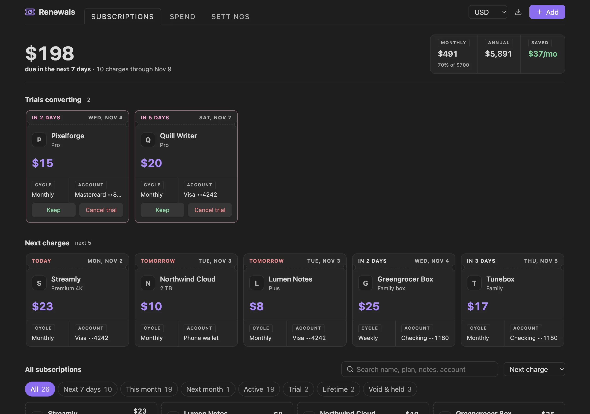
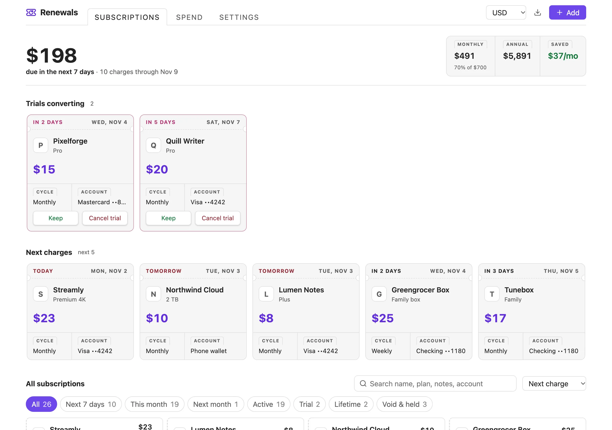
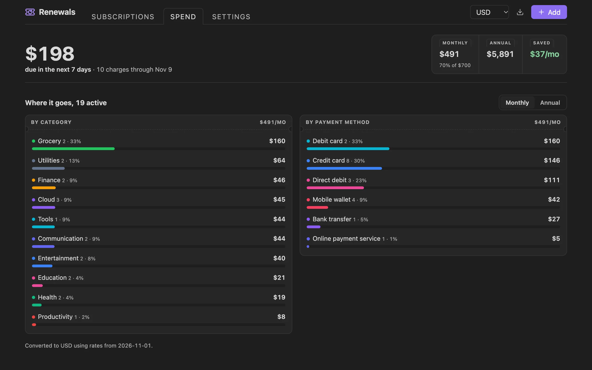
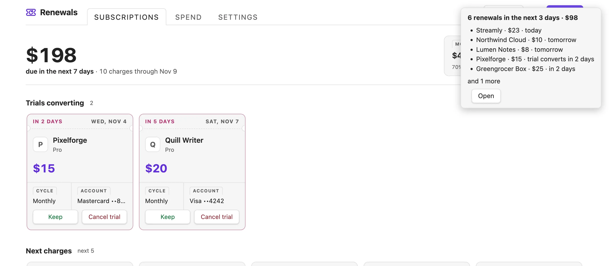
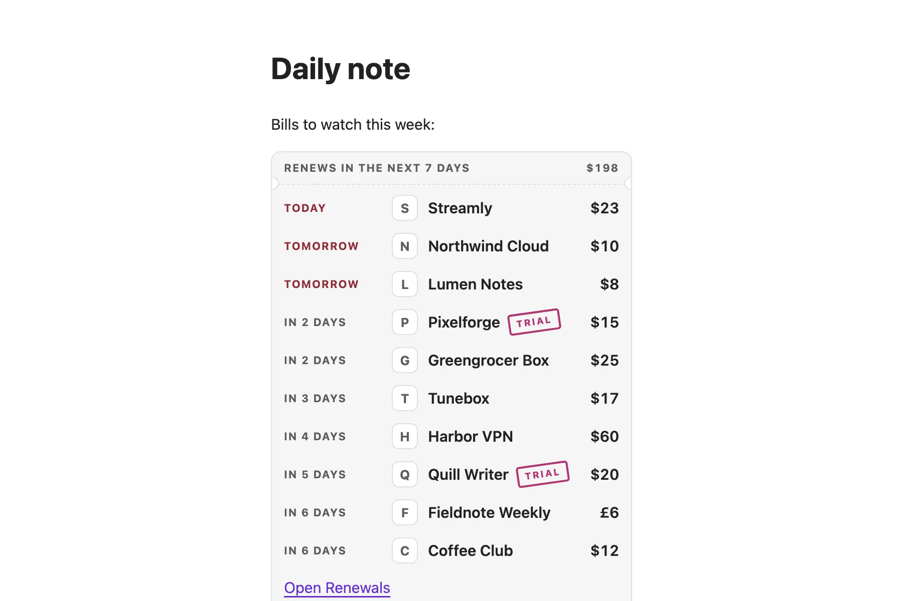
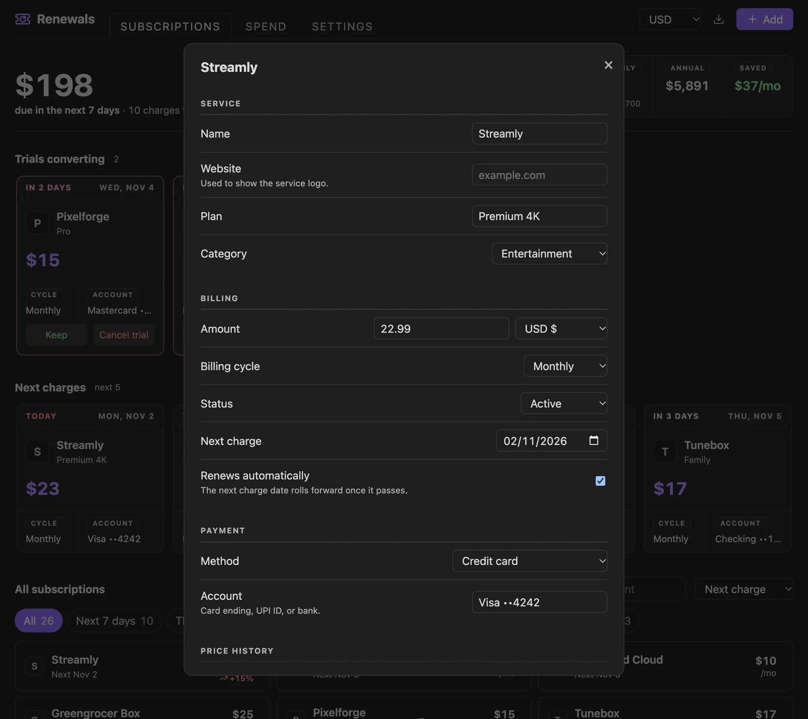
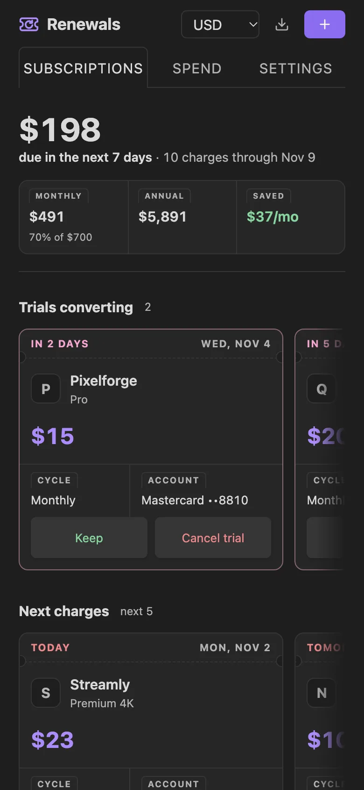
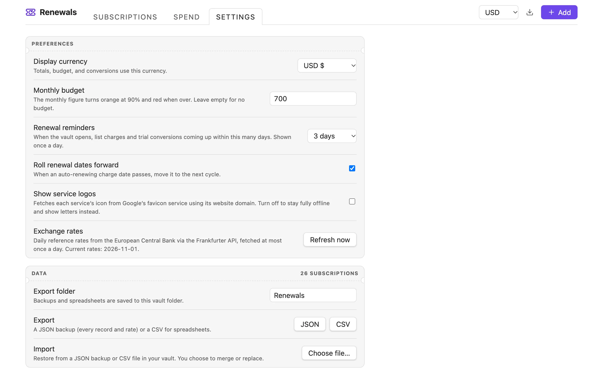

<p align="center">
  
</p>

<h1 align="center">Renewals: Subscription Manager</h1>

<p align="center">
  Track subscriptions, free trials, and recurring payments inside your Obsidian vault.<br>
  See what renews next, catch trials before they charge, and know where the money goes.
</p>

<p align="center">
  <a href="https://github.com/varunlakshmaiah/obsidian-renewals/releases/latest"></a>
  
  
  <a href="LICENSE"></a>
</p>

<p align="center">
  
</p>

## Why Renewals

Subscription apps want an account and your bank login. Renewals keeps everything in your vault, works offline, and opens on the one question that matters: **what is about to charge me?**

- Every subscription in one place, with the next charge on top
- Trials surface before they convert, with one-click **Keep** or **Cancel trial**
- Totals in any of 32 currencies, normalised across weekly, monthly, quarterly, and yearly billing
- No account, no telemetry, no dependencies

## Features

### Subscriptions at a glance

The dashboard leads with what's **due in the next 7 days**, beside your monthly, annual, and saved totals. Trials ending within 14 days sit in their own row, followed by the next five charges as coupons showing the amount, date, billing cycle, and payment account.

Every subscription is listed below, sorted by next charge and stamped by state:

| Stamp | Meaning |
|---|---|
| `TRIAL` | A free trial that will convert to paid |
| `PAID` | Charged in the last 3 days |
| `LIFETIME` | A one-time purchase |
| `HELD` | Paused |
| `VOID` | Cancelled, kept for your records |

Search by name, plan, notes, or account; filter by next 7 days, this month, next month, active, trial, lifetime, or void and held; sort by next charge, amount, or name. Right-click (or long-press on mobile) any subscription to edit, duplicate, pause, cancel, reactivate, or delete it. Cancelling and deleting can be undone from the notice.

<p align="center">
  
</p>

### Spend breakdown

See where the money goes by category and by payment method, monthly or annual. Set an optional **monthly budget** and the monthly figure turns orange at 90% and red when you go over.

<p align="center">
  
</p>

### Reminders before you're charged

When your vault opens, Renewals lists the charges and trial conversions coming up within your chosen window (1, 3, 7, or 14 days). It shows once a day, and you can turn it off.

<p align="center">
  
</p>

### Embed in any note

Add a `renewals` code block to a note, such as your daily note, to see what's renewing soon. It updates whenever your subscriptions change, and each row opens that subscription for editing.

````markdown
```renewals
days: 7
```
````

`days` is optional and defaults to 7.

<p align="center">
  
</p>

### Add and edit

Record the name, website, plan, category, amount and currency, billing cycle, status, next charge or trial end, payment method and account, and notes. Changing the amount logs the old and new price automatically.

<p align="center">
  
</p>

### Built for mobile too

The layout adapts to the width of the pane, not just the screen, so it works in a sidebar, a split, or on your phone. Buttons grow to comfortable touch targets on narrow screens.

<p align="center">
  
</p>

### Settings and data

Everything is configurable from the **Settings** tab inside the dashboard, or from the plugin's entry in Obsidian's settings.

<p align="center">
  
</p>

- **Display currency**: totals, budget, and conversions use this currency
- **Monthly budget**: optional; leave empty for none
- **Renewal reminders**: off, 1, 3, 7, or 14 days
- **Roll renewal dates forward**: move passed auto-renew dates to the next cycle
- **Show service logos**: turn off to make no logo requests
- **Exchange rates**: refresh on demand
- **Export and import**: JSON backups and CSV spreadsheets, saved to and restored from a folder in your vault (works on mobile)

## Commands

| Command | What it does |
|---|---|
| Open dashboard | Opens Renewals in a tab |
| Add subscription | Opens the add form |
| Show what renews this week | Opens the dashboard filtered to the next 7 days |
| Show renewal reminders | Shows the reminder notice now |
| Export backup (JSON) | Saves every record and rate to your export folder |
| Export spreadsheet (CSV) | Saves a CSV to your export folder |
| Import backup | Restores from a JSON or CSV file in your vault, merging or replacing |
| Roll overdue renewal dates forward | Moves passed auto-renew dates to the next cycle |

## Installation

### From Community plugins

1. Open **Settings → Community plugins** and turn off **Restricted mode** if it's on.
2. Click **Browse**, search for **Renewals**, then **Install** and **Enable**.

### Manually

1. Download `main.js`, `manifest.json`, and `styles.css` from the [latest release](https://github.com/varunlakshmaiah/obsidian-renewals/releases/latest).
2. Put them in `<your vault>/.obsidian/plugins/renewals/`.
3. Reload Obsidian and enable **Renewals: Subscription Manager** under **Settings → Community plugins**.

Open it from the ribbon icon or the command palette.

## Privacy and network use

Your subscriptions are stored only in this plugin's data file inside your vault. There is no account, no telemetry, and no analytics.

Renewals makes two kinds of network request:

- **Exchange rates**: at most once a day it fetches the European Central Bank's daily reference rates from the [Frankfurter API](https://frankfurter.dev). No personal data is sent. If the request fails, the last cached rates (or a built-in table) are used.
- **Service logos**: when a subscription has a website, its icon is loaded from Google's favicon service using only that website's domain. Turn off **Show service logos** to make no logo requests and show letter tiles instead.

## Development

There is no build step: `main.js` and `styles.css` are the shipped files.

```bash
git clone https://github.com/varunlakshmaiah/obsidian-renewals.git
cd obsidian-renewals
python3 -m http.server 8765
```

- **Preview**: open <http://127.0.0.1:8765/preview/index.html> to run the plugin in a browser against a stand-in for the Obsidian API, with fictional demo data and theme, accent, and pane-width switches.
- **Tests**: open <http://127.0.0.1:8765/preview/test.html> to run the automated suite (date maths, CSV parsing, data migration, every tab, filters, sorting, undo, add and edit, export and import, budget, reminders, the note embed, and basic accessibility checks).

To try changes in Obsidian, symlink or copy the repository into `<vault>/.obsidian/plugins/renewals/` and toggle the plugin off and on.

## Support

Found a bug or have an idea? [Open an issue](https://github.com/varunlakshmaiah/obsidian-renewals/issues/new/choose).

## License

[MIT](LICENSE) © Varun Lakshmaiah
